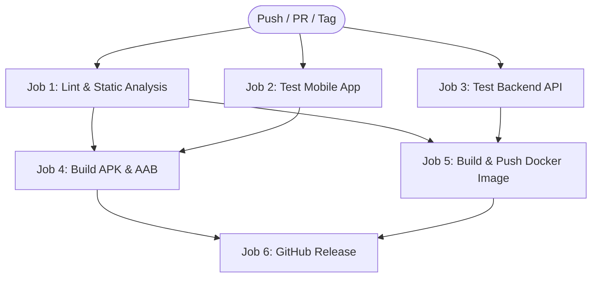

# CI/CD Pipeline & GitHub Actions Setup Guide

This guide details the continuous integration and delivery architecture for the **Golden Hour** platform, covering automated linting, test suites, artifact compilation, containerization, and release deployments.

---

## 1. Pipeline Overview

The CI/CD pipeline is implemented in [`.github/workflows/ci.yml`](file:///home/thotaganesh/RESTART/Golden_Hour/.github/workflows/ci.yml). It executes automatically on:
- Pushes to `main` and `next-updates` branches
- Pull Requests targeting `main` and `next-updates`
- Git tags matching `v*` (e.g. `v1.0.4`)
- Manual trigger via GitHub Actions `workflow_dispatch`

### Pipeline Stages & Jobs



| Job | Environment | Key Operations | Artifacts / Outputs |
|---|---|---|---|
| **`lint`** | `ubuntu-latest` | `flutter analyze --no-fatal-infos`, `ruff check backend/` | Zero-violation verification |
| **`test-mobile`** | `ubuntu-latest` | `flutter test --coverage` (93+ unit/widget tests) | Coverage report (`coverage/lcov.info`) |
| **`test-backend`** | `ubuntu-latest` | `pytest tests -v` (36 unit/endpoint tests) | Pytest execution results |
| **`build-mobile`** | `ubuntu-latest` | `flutter build apk --release`, `flutter build appbundle --release` | `golden-hour-release-apk`, `golden-hour-release-aab` |
| **`docker-backend`** | `ubuntu-latest` | Docker Buildx multi-stage build, push to GHCR | `ghcr.io/<owner>/golden-hour/backend:<tag>` |
| **`release`** | `ubuntu-latest` | Runs on tags `v*`; downloads mobile artifacts and publishes GitHub Release | GitHub Release with APK & AAB binaries |

---

## 2. GitHub Repository Secrets

Configure the following secrets in **GitHub Repository Settings $\rightarrow$ Secrets and variables $\rightarrow$ Actions**:

### Mobile Signing Secrets (Android)
| Secret Name | Description | Example / Format |
|---|---|---|
| `KEYSTORE_BASE64` | Base64-encoded Android release `.jks` or `.keystore` file | Run `base64 -w 0 upload-keystore.jks` |
| `STORE_PASSWORD` | Password for the Java Keystore | Strong passphrase |
| `KEY_PASSWORD` | Password for the key alias | Strong passphrase |
| `KEY_ALIAS` | Name of the key alias in the keystore | e.g. `upload`, `goldenhour` |

> [!NOTE]
> If `KEYSTORE_BASE64` is omitted, the CI workflow gracefully falls back to debug signing without failing the build. This allows contributors and pull requests to build test binaries safely.

### Backend & Cloud Secrets
| Secret Name | Description | Used In |
|---|---|---|
| `GITHUB_TOKEN` | Automatically supplied by GitHub Actions | GHCR login, release notes creation |
| `FIREBASE_TOKEN` / `FIREBASE_SERVICE_ACCOUNT` | Firebase Admin SDK credentials for FCM push delivery | Production deployment |

---

## 3. Generating & Encoding Android Release Keystore

To generate an upload keystore and prepare it for GitHub Actions:

```bash
# 1. Generate keystore
keytool -genkey -v -keystore upload-keystore.jks \
  -keyalg RSA -keysize 2048 -validity 10000 \
  -alias upload

# 2. Encode to base64 for GitHub Secrets
base64 -w 0 upload-keystore.jks > upload-keystore.base64.txt

# 3. Copy contents of upload-keystore.base64.txt into KEYSTORE_BASE64 secret in GitHub
```

---

## 4. Semantic Release & Conventional Commits

Version bumping and changelog maintenance follow the [Conventional Commits](https://www.conventionalcommits.org/) standard, governed by [`release.config.js`](file:///home/thotaganesh/RESTART/Golden_Hour/release.config.js).

### Commit Format Rules
- `feat(...)`: Increments **MINOR** version (e.g. `1.0.4` $\rightarrow$ `1.1.0`)
- `fix(...)`: Increments **PATCH** version (e.g. `1.0.4` $\rightarrow$ `1.0.5`)
- `perf(...)`: Increments **PATCH** version
- `docs(...)`, `refactor(...)`: Increments **PATCH** version
- `chore(...)`, `test(...)`: No version increment (maintenance)
- `BREAKING CHANGE:` in commit footer increments **MAJOR** version

---

## 5. Non-Clinical Compliance Statement

Golden Hour's CI/CD release pipeline ensures that all generated artifacts, release notes, and store metadata strictly adhere to India DPDPA 2023 regulations and non-clinical positioning. Golden Hour is branded and operated as an emergency safety QR and ICE family notification utility, not as a diagnostic medical device or healthcare provider.

